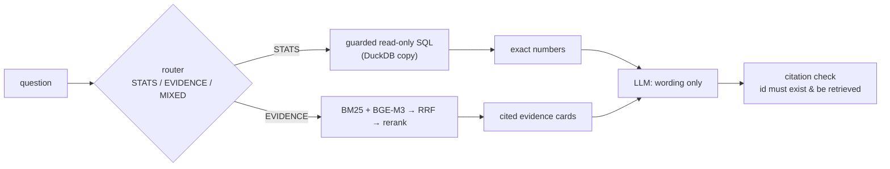

# GuardLens

**RAG-native security analytics for autonomous agent audit logs.**

GuardLens turns the JSONL audit trail of an AI coding agent's permission gate —
every tool call with its allow/deny decision — into a dataset you can *query*,
*explain* and *evaluate*. Answers come with traceable evidence ids, numbers come
from SQL, and everything runs on your own machine.

[](LICENSE)
[](https://www.python.org/)
[](https://github.com/astral-sh/ruff)

---

## Why

Agent audit logs are the first security telemetry most teams will ever have
about autonomous software — and they are unusable as-is: one line per tool call,
thousands of rows, a `reason` string written by a policy engine. Dashboards
count them. Chatbots guess about them. GuardLens does neither:

* **numbers are never generated** — STATS questions are answered by guarded
  read-only SQL over DuckDB and passed to the model verbatim;
* **explanations are never unsourced** — every sentence cites an
  `evidence_id` that must exist *and* be in that question's retrieved set;
* **abstention is a feature** — when evidence is missing the answer is
  "not found in the logs", not a plausible guess;
* **the retrieval is measured** — a golden set, a retrieval ablation and
  citation/abstention accuracy are part of the repo, not the sales pitch.

## Features

| | |
|---|---|
| **Ingest** | streaming JSONL → Pydantic validation → DuckDB; malformed `args` repaired, bad rows quarantined with line numbers |
| **Search** | BM25 (exact commands/paths/URLs) + BGE-M3 dense in Qdrant → type-balanced RRF → `bge-reranker-v2-m3` |
| **Answer** | cited Q&A with post-hoc citation verification, deterministic-numbers passthrough, explicit abstention |
| **Route** | deterministic STATS / EVIDENCE / MIXED router; free-form SQL behind three gates (SELECT-only, read-only copy, dry-run + row cap) |
| **Analyse** | risk-family attribution, bypass-sequence detection (`curl → web_fetch`), false-positive proxies with a 👍/👎 feedback loop |
| **Serve** | Streamlit dashboard + FastAPI/SSE backend that loads models once |
| **Measure** | 20-question golden set, retrieval ablation, latency and token-cost accounting |

## Quick start

Requirements: Python 3.12+ and [uv](https://docs.astral.sh/uv/). Optional:
Docker (local Qdrant) and an OpenAI-compatible LLM key.

```bash
git clone <repo-url> guardlens && cd guardlens
uv sync

# 1) try the pipeline on the bundled synthetic log (42 events, all fictional)
uv run python -m guardlens.ingest \
  --input data/sample/audit-sample.jsonl \
  --db data/derived/sample.duckdb

# 2) open the dashboard on that database
#    (the metrics and signal tabs need no model, no Docker, no API key)
GUARDLENS_DB=data/derived/sample.duckdb uv run streamlit run app.py
```

> The dashboard UI is in Chinese; the code, docs and CLI are English.

### Your own audit log

```bash
uv run python -m guardlens.ingest \
  --input "/path/to/audit.jsonl" \
  --db data/derived/guardlens.duckdb
```

The default database path is `data/derived/guardlens.duckdb`, so the dashboard
picks it up without configuration.

Record shape (one JSON object per line):

```json
{"ts": "2026-09-06T09:00:09.000Z", "tool": "bash", "category": "network",
 "decision": "deny", "reason": "BLOCKED (network): network, not rollback-able",
 "targetPaths": [], "args": {"command": "curl -s https://example.com/x"}}
```

Optional `--redact` rewrites `/<home>/<user>` → `/Users/user` and scrubs
emails, IPv4 addresses and token-ish assignments — use it before sharing any
derived dataset. Optional `--baseline baseline.json` prints a regression diff
against a previous snapshot and exits non-zero on data loss.

### The full retrieval path (Qdrant + models)

```bash
docker compose up -d                      # local Qdrant on 127.0.0.1:6333
uv run python -m guardlens.build_index --db data/derived/guardlens.duckdb \
  --reports /path/to/turn-reports
uv run python -m guardlens.migrate_qdrant
uv run uvicorn guardlens.server:app --port 8000   # models load once (~1 min)
uv run streamlit run app.py                        # dashboard talks to :8000
```

First indexing run downloads BGE-M3 (~2 GB) and the reranker; on Apple Silicon
MPS is detected automatically (≈6.5 min for 5.5k docs) with CPU fallback. Qdrant
is published on `127.0.0.1` only — it has no authentication, so do not expose it.

## Configuration

Retrieval, analytics, embedding and evaluation need **no** credentials. Only
the answer step needs an OpenAI-compatible chat endpoint:

| Variable | Purpose |
|---|---|
| `GUARDLENS_LLM_API_KEY` | API key (explicit override) |
| `GUARDLENS_LLM_BASE_URL` | e.g. `https://api.deepseek.com`, `https://api.openai.com/v1`, any gateway |
| `GUARDLENS_LLM_MODEL` | model name (default `gpt-4o-mini`) |
| `OPENAI_API_KEY` / `OPENAI_BASE_URL` | conventional fallback names |

```bash
export GUARDLENS_LLM_API_KEY=...  GUARDLENS_LLM_BASE_URL=https://api.openai.com/v1
```

No key is hard-coded; keys are never logged or printed. `.env` is git-ignored —
copy [`.env.example`](.env.example) if you like.

## Architecture



Details: [docs/architecture.md](docs/architecture.md) · retrieval design:
[docs/retrieval.md](docs/retrieval.md) · design decisions:
[docs/adr](docs/adr) · build history: [docs/milestones.md](docs/milestones.md).

## Evaluation

20-question golden set (STATS / EVIDENCE / MIXED, including two deliberately
unanswerable questions), retrieval ablation, citation and abstention accuracy:

| Metric | Result |
|---|---|
| Recall@5 (all 20) | 79.6% |
| Recall@5 (14 evidence/mixed) | 70.9% |
| Citation accuracy | 100% |
| Abstention accuracy | 100% |
| Deterministic-number accuracy | 100% |
| p50 / p95 latency | ≈ 2.0 s / 3.0 s |

Hybrid retrieval lifts Recall@5 from ~14% (dense only) to ~52%, and the
cross-encoder to ~66% on the same questions. Results, caveats and how to
reproduce: [docs/evaluation.md](docs/evaluation.md).

```bash
uv run python -m eval.run_eval --ablation-only   # no LLM key needed
uv run python -m eval.run_eval                   # end-to-end, needs a key
```

## Repository layout

```
src/guardlens/     ingest · parsing · schema · duckdb · corpus · bm25 · hybrid
                   reranker · qdrant_store · router · sql_tool · orchestrator
                   qa · analytics · feedback · redaction · llm_config · server
app.py             Streamlit dashboard (metrics / cited Q&A / security signals)
eval/              golden20.yaml · run_eval.py · reports · recall diagnostics
examples/          headless Q&A, W2-vs-W3 comparison, sample-data generator
data/sample/       synthetic 42-event audit log (fictional, committed)
docs/              architecture · retrieval · evaluation · milestones · ADRs
articles/          long-form write-ups of the design decisions
tests/             unit tests (no network, no model download)
```

## Development

```bash
uv run pytest
uv run ruff check .
uv run ruff format --check .
```

Tests run without network access or model downloads. CI runs the same three
commands on Python 3.12.

## Data & privacy

* **Nothing is committed but synthetic or redacted data.** Raw logs, DuckDB
  files, parquet, vector stores and model caches are git-ignored.
* The bundled sample is entirely fictional (RFC 2606 domain, `/Users/user`
  paths, `example.com` hosts).
* `--redact` exists for producing shareable datasets; `redaction.py` is unit
  tested.
* Retrieval, embedding, analytics and evaluation are local. The only outbound
  call is the LLM endpoint **you** configure.
* Command lines from the log are parsed statically (`shlex`), never executed.

## Contributing

Issues and pull requests are welcome — start with
[CONTRIBUTING.md](CONTRIBUTING.md) and [CODE_OF_CONDUCT.md](CODE_OF_CONDUCT.md).
For anything security-related, follow [SECURITY.md](SECURITY.md) instead of
opening a public issue.

## License

MIT — see [LICENSE](LICENSE). Copyright (c) 2026 Chaojie Tian.
