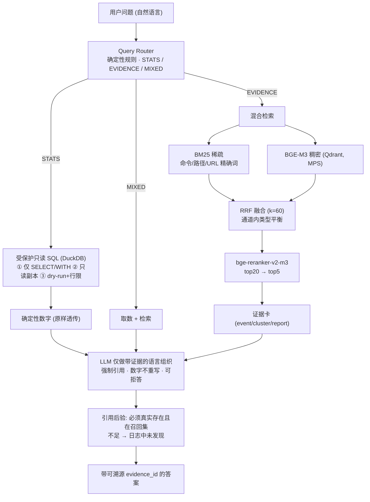

# GuardLens 🛡️

**RAG-native security analytics for autonomous Agent audit logs.**

GuardLens turns a JSONL audit trail produced by an AI-coding-agent permission gate (tool calls with allow/deny decisions) into a queryable, measurable, **fully local** dataset.

> **Privacy & locality (hard constraints).** This project is **100% local**: no
> public deployment, no cloud host, no public remote, no inbound/outbound demo
> port. Raw logs, the DuckDB/Qdrant stores and the model cache are git-ignored
> and never committed. Everything written into this README, the eval report and
> the articles uses **redacted, aggregate data** — no real usernames, home
> paths, internal hosts/IPs, emails, or raw log lines.

Milestones: W1 data foundation + DuckDB metrics · W2 first RAG loop (BGE-M3/Chroma, cited Q&A) · W3 hybrid retrieval (BM25 + dense RRF + rerank) on Qdrant, guarded read-only SQL router, three security analyses · **W4 (current): 20-question golden-set evaluation, retrieval ablation, latency/cost accounting, portfolio write-up.**

## Architecture

Security numbers must be exact, but security *triage* is semantic. GuardLens keeps them on three separate rails and joins them only at the last, citation-checked step.



Data plane (all local): `audit.jsonl → ingest → DuckDB`; `DuckDB + turn reports → corpus (5.5k cards/chunks) → BGE-M3 → Qdrant`; an in-memory BM25 index is built from the same corpus. Signals (risk families / evasion / false-positive proxies) are computed deterministically over DuckDB; human 👍/👎 feedback lands in a separate DuckDB that never touches audit data.

## Quick start (local only)

Requires [uv](https://docs.astral.sh/uv/) (Python 3.12+) and, for the Q&A/signals tabs, Docker for a **local, non-exposed** Qdrant container.

```bash
# 1. install deps (creates .venv automatically)
uv sync

# 2. ingest YOUR OWN local audit log into DuckDB (full reload, bad rows -> quarantine)
#    Replace the path with a local file on your machine; nothing is uploaded.
uv run python -m guardlens.ingest \
  --input "/path/on/your/machine/audit.jsonl" \
  --db data/derived/guardlens.duckdb

# 3. (W3/W4) start local Qdrant + build/embed the corpus, then migrate
docker compose up -d                      # 127.0.0.1 only, persistent local volume
uv run python -m guardlens.build_index --db data/derived/guardlens.duckdb
uv run python -m guardlens.migrate_qdrant

# 4. open the dashboard (W1 metrics / W3 hybrid Q&A / W3 security signals)
uv run streamlit run app.py               # binds localhost; do not expose publicly

# 5. (W4) run the golden-set evaluation and the retrieval ablation
uv run python -m eval.run_eval            # writes eval/eval_report.md + results.json
```

A redacted public sample can be produced with `--redact` (rewrites home paths and scrubs emails/IPs/token-ish fields).

## W2 — evidence-grounded RAG Q&A

```bash
# 1. build semantic cards/clusters + report chunks, embed with local BGE-M3,
#    and persist into Chroma (first run downloads the ~2GB model; on Apple
#    Silicon it auto-uses the Metal/MPS GPU: ~7 min for 5.5k docs at seq384,
#    vs ~22 min on CPU). HF mirror is used by default.
uv run python -m guardlens.build_index \
  --db data/derived/guardlens.duckdb \
  --reports "/path/on/your/machine/reports"   # local dir of turn reports

# 2. ask an evidence question headlessly (prints streaming answer + citations)
uv run python examples/eval_qa.py
```

Then open the **💬 问答（W2 RAG）** tab in Streamlit.

## W3 — production hardening & differentiated security analytics (v0.3-prod)

W3 keeps the W2 evidence loop but swaps the retrieval backbone for a
production stack and adds three security-domain analyses. Chroma remains on
disk as the W2 fallback/baseline; **Qdrant is the primary store**.

```bash
# 1. start Qdrant (local persistent volume). If Docker Hub is unreachable,
#    pull via a mirror and re-tag, e.g.:
#      docker pull docker.1ms.run/qdrant/qdrant:v1.12.4
#      docker tag  docker.1ms.run/qdrant/qdrant:v1.12.4 qdrant/qdrant:v1.12.4
docker compose up -d                 # Qdrant on :6333 (REST/UI) :6334 (gRPC)

# 2. (re)build the corpus, then embed with BGE-M3 on MPS and migrate to Qdrant.
#    Payload carries ts/tool/category/decision/doc_type/evidence_id -> server
#    side pre-filtering. 5,469 docs ~6.5 min on M5 MPS.
uv run python -m guardlens.build_index --db data/derived/guardlens.duckdb \
  --reports "/path/on/your/machine/reports"
uv run python -m guardlens.migrate_qdrant

# 3. W2-vs-W3 retrieval comparison (same questions, Recall@5, no LLM calls)
uv run python examples/eval_w2_vs_w3.py
```

**Hybrid retrieval + rerank** (`bm25.py`, `hybrid.py`, `reranker.py`):

* **dense**: BGE-M3 (MPS) top-N from Qdrant; **sparse**: a dependency-free
  BM25 whose tokenizer keeps shell commands/flags/paths/URLs as exact terms
  and indexes Chinese as overlapping bigrams, with anchor-body term boosting;
* per-channel **type balancing** before **RRF (k=60)** fusion into a top-20
  pool (the ~3.4× more numerous report chunks otherwise monopolise RRF);
  intent expansions (绕过→`curl web_fetch 同 URL 换工具`) bridge abstract
  phrasings to exact command cards;
* **bge-reranker-v2-m3** cross-encodes the pool on MPS (≈10 pairs/s vs ≈4 on
  CPU) and the result is rerank-dominant with minimal anchors (exact payload
  filters, best-RRF candidate) so rare real events are never buried.
* Measured on the same 8-question set: **mean Recall@5 0.507 (W2) → 0.647
  (W3)**; exact-term/evasion questions improve most.

**Query Router + guarded Text2SQL** (`router.py`, `sql_tool.py`,
`orchestrator.py`): questions are deterministically routed to **STATS /
EVIDENCE / MIXED**. STATS answers come from DuckDB and numbers are passed to
the LLM **verbatim**; free-form SQL sits behind three gates — SELECT/WITH
only, a read-only **copied** sandbox DB, and dry-run + row cap. See
[ADR 0001](docs/adr/0001-stats-via-guarded-sql-not-llm.md).

**Differentiated analytics** (`analytics.py`, 🚨 tab):

* **风险族归因** — the 1,139 deny events merge into risk families
  (外联 / 越界写 / 进程命令 / fail-closed / 不可回滚-unknown / 数据走私) with
  family counts + representative events; the headline finding is
  **unknown ≈ 75% → conservative policy + observability blind spot**.
* **绕过序列检测** — deny(A) → a same-intent call(B) within a window with both
  sides showing network intent (curl→web_fetch, web_fetch→python urllib,
  `-A Mozilla` UA spoof, a read-only proxy gateway); 19 high-confidence signals.
* **误拦代理分析 + 反馈闭环** — same substantive action (intent signature over
  network/package/permission/convert verbs + target) denied then allowed
  within N minutes = a policy-tuning hint; 👍/👎 is written to a **separate**
  `feedback.duckdb` (audit data never mutated). It is a proxy, not a true FP
  rate — human confirmation is the point.

Citation hardening: every cited id must both exist in the corpus **and** be in
that question's retrieved set, else it is flagged invalid; insufficient
evidence still yields “日志中未发现”.


**Pipeline.** `corpus.py` builds three document types from DuckDB + the
plugin's `turn-*.md` reports:

* `event_card` — every deny / fail-closed / high-risk-allow event with its
  **±5 surrounding events**, so an interception is understood in context
  (e.g. `curl` denied → `web_fetch` to the same URL two seconds later);
* `event_cluster` — sessions split by a 10-minute idle gap that contain
  at least one deny/fail-closed event;
* `report_chunk` — turn reports split by H2 section.

`vectorstore.py` embeds them locally with **BGE-M3** (1024-d; embedding input
capped at 384 tokens for speed while full text is still stored for the LLM)
into Chroma (cosine). It auto-selects **Apple Metal/MPS** when available
(`device="mps"` with a real-encode probe, falling back to CPU; override with
the Embedder `device=` arg), uses batch 64 on GPU, and—if the model is cached—
runs HuggingFace in offline mode to skip the slow huggingface.co HEAD retry.
`retriever.py` does dense
top-k with two W2-only pragmatic fixes (W3 adds BM25 + rerank): a per-type
quota so concrete event cards aren't drowned by near-duplicate report chunks,
and a **structured fallback** that anchors rare-but-real events (the 5
fail-closed rows, `chmod`/`sudo` attempts) via metadata/keyword filters.

**LLM.** No key is hard-coded. `llm_config.py` resolves an OpenAI-compatible
endpoint from, in order: `GUARDLENS_LLM_*` env, `DEEPSEEK_API_KEY` (legacy-harness
credentials → api.deepseek.com), or `VOLC_ARK_API_KEY` (Volcengine Ark coding
endpoint). The Q&A prompt enforces: every claim cites a retrieved evidence id,
numbers come from injected DuckDB `<stats>` (never invented), and insufficient
evidence → “日志中未发现”. `qa.py` post-verifies every citation; SSE-style
token streaming is exposed via `QAEngine.stream`.

The ingest command prints core metrics and a **baseline diff** against a
frozen 2026-09-19 snapshot of the author's corpus (21,754 events / 20,629
allow / 1,125 deny / 5 fail-closed). Because the audit log is append-only
and the autonomous agent keeps running, volume metrics are compared with
**monotonic semantics** (`actual >= baseline` → healthy `OK+`; a smaller
number means data loss), while the structural `fail-closed = 5` invariant
must still match exactly. Counts are always recomputed — the baseline is
never used to fabricate results, and an unhealthy diff exits non-zero.

Latest local run (live corpus): **21,977 events / 20,839 allow / 1,138 deny
(5.18%) / 5 fail-closed / 0 quarantined**, ingested in ~6s.

**Dirty-data handling**: ~15 upstream rows wrote `args` as a double-encoded
or truncated JSON string. The loader first tries strict `json.loads`, then a
lax recovery (best-effort key extraction, raw payload preserved under
`args._raw_args`); only rows failing the core schema are quarantined with
their line number.

## W4 — offline evaluation & portfolio hardening

Everything runs locally against the redacted corpus; numbers are produced by
the harness, never hand-edited. See [`eval/eval_report.md`](eval/eval_report.md).

```bash
uv run python -m eval.run_eval               # E2E (20 Qs) + retrieval ablation
uv run python -m eval.run_eval --ablation-only   # retrieval grid, no LLM calls
```

* **Golden set** [`eval/golden20.yaml`](eval/golden20.yaml): 20 questions —
  STATS / EVIDENCE / MIXED, including **2 deliberately unanswerable** questions
  (reverse-shell, cryptominer) that probe hallucination/abstention. Each has
  gold evidence ids + expected points.
* **Metrics**: retrieval Recall@5, citation accuracy (cited id must exist AND
  be in the retrieved set), abstention accuracy, deterministic-number
  accuracy, p50/p95 latency, prompt/completion token cost.
* **Retrieval ablation** (Recall@5, retrieval-only, no LLM):

| Retrieval mode | K=3 | K=5 | K=8 |
|---|---|---|---|
| dense vectors only (W2-style) | 11% | **14%** | 14% |
| BM25 + dense RRF, no rerank | 37% | **52%** | 52% |
| hybrid + bge-reranker | 44% | **66%** | 66% |

Hybrid retrieval lifts Recall@5 from ~14% → ~52%, and the cross-encoder to
**66%** (K=5); K=5 is the sweet spot (K=3 misses, K=8 adds nothing) — the
quantitative basis for "retrieve wide, rerank strict, answer from 5". End-to-end
metrics over all 20 questions are in the report (STATS questions are
number-grounded and counted as full recall): **20-question Recall@5 79.6%**
(**70.9%** on the 14 evidence/mixed questions), **citation accuracy 100%,
abstention accuracy 100%, deterministic-number accuracy 100%**, p50/p95
latency ≈ 2.0s/3.0s, and per-question token cost included.

Technical write-ups (redacted, aggregate data only):
[`articles/01-siem-rag-the-right-way.md`](articles/01-siem-rag-the-right-way.md),
[`articles/02-why-not-let-llm-compute-numbers-sql-router.md`](articles/02-why-not-let-llm-compute-numbers-sql-router.md).

### Build a public, redacted sample

```bash
uv run python -m guardlens.ingest --redact \
  --input  "/path/on/your/machine/audit.jsonl" \
  --db     data/derived/guardlens-public.duckdb
```

`--redact` rewrites `/Users/<name>` → `/Users/user` and scrubs emails, IPv4
addresses, and token-ish assignments in `reason`/`args`/`targetPaths`.

## Development

```bash
uv run pytest        # unit tests
uv run ruff check .  # lint
uv run ruff format . # format
```

## Data source & privacy

- **Source**: an `audit.jsonl` audit trail, one JSON object per line:
  `ts, tool, category, decision, reason, targetPaths, args, snapshotId?`.
- **Local-only by design**: no public deployment, no cloud host, no public
  remote, no publicly exposed port; Qdrant binds to `127.0.0.1`. The repository
  is intended to stay private/local.
- Raw logs, derived DuckDB/parquet files, the Qdrant volume, the Chroma store
  and the model cache are all **git-ignored** and never committed. Only a
  redacted sample may be shared, and `--redact` (home-path rewrite + email/IP/
  token scrubbing) exists for that purpose.
- All docs, the eval report and the articles use **redacted, aggregate** data
  only — no real usernames, home paths, internal hosts/IPs, emails or raw log
  lines. `scripts/privacy_check`-style greps guard the committed prose (see the
  W4 task notes); you can re-run the checks in `tests` before publishing.
- The only outbound call is to the LLM endpoint **you configure** (your own
  key); retrieval, embeddings and analytics all run locally. No key is
  hard-coded, and credentials are never printed or committed.
- All command-line parsing is static (`shlex`, no execution).


## License

MIT — see [LICENSE](LICENSE).
