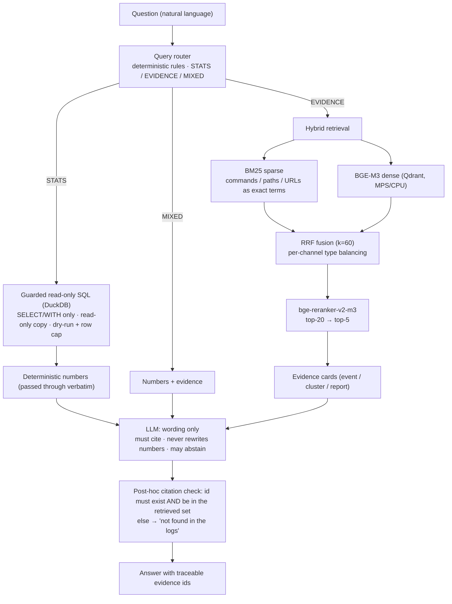

# Architecture

GuardLens turns an append-only audit trail from an autonomous coding agent's
permission gate into two different kinds of answers:

* **exact numbers** (how many denies, which tool, which risk family), and
* **semantic explanation** (why *this* command was intercepted, what happened
  around it).

Security telemetry needs both, and they fail differently: an LLM doing
arithmetic invents numbers, while a pure dashboard cannot explain intent. The
design keeps the two on separate rails and joins them only at the last,
citation-checked step.

## Request flow



## Data plane (all local)

```
audit.jsonl ──ingest──▶ DuckDB (events)
DuckDB + turn reports ──corpus──▶ evidence cards/chunks ──BGE-M3──▶ Qdrant (+ BM25 in memory)
DuckDB ──analytics──▶ risk families / bypass sequences / false-positive proxies
human 👍👎 ──feedback──▶ feedback.duckdb (never touches audit data)
```

Nothing leaves the machine. The only outbound call is the LLM endpoint you
configure; retrieval, embedding and analytics run locally.

## Corpus: what gets retrieved

Three document types are derived from DuckDB plus the gate's per-turn Markdown
reports:

| Type | Built from | Purpose |
|---|---|---|
| `event_card` | every deny / fail-closed / high-risk-allow event **plus ±5 surrounding events** | lets the model see an interception *in context* (e.g. `curl` denied → `web_fetch` to the same URL two seconds later) |
| `event_cluster` | sessions split by a 10-minute idle gap containing at least one deny / fail-closed | session-level evidence for "sequence" questions |
| `report_chunk` | turn reports split by `##` section | the agent's own narrative for that turn |

Embedding input is capped at 384 tokens for indexing speed, while full text is
kept for the LLM prompt.

## Guarded SQL

Free-form SQL is the riskiest component, so it sits behind three independent
gates (`sql_tool.py`):

1. statement must be `SELECT` / `WITH` only (no DDL/DML/pragmas);
2. queries run against a **copied, read-only** DuckDB sandbox file;
3. a dry run plus a hard row cap bounds cost and result size.

See [ADR 0001](adr/0001-stats-via-guarded-sql-not-llm.md) for the reasoning.

## Answer contract

The Q&A prompt (`qa.py`) enforces three rules, and the code verifies the third:

* every claim cites a retrieved `evidence_id`;
* numbers come from injected DuckDB `<stats>`, never from the model;
* insufficient evidence → the abstention string `日志中未发现` ("not found in
  the logs").

Citations are re-checked after generation: an id must both exist in the corpus
**and** appear in that question's retrieved set, otherwise it is flagged
invalid. Streaming tokens are exposed through `QAEngine.stream` and over SSE
from the FastAPI backend, so the dashboard can render an answer as it arrives.

## Serving topology

```
app.py (Streamlit)  ──HTTP+SSE──▶  guardlens.server (FastAPI)
                                     └── loads BGE-M3 / reranker / Qdrant client once
```

The heavy models load once in the backend process, so a browser refresh in the
dashboard never pays the ~80 s cold-start again. `app.py` also has a direct
in-process path for headless use (`examples/eval_qa.py`).

## Interfaces

| Surface | File | What it gives you |
|---|---|---|
| Dashboard | `app.py` | KPI/trends from DuckDB, cited Q&A with an evidence drawer, security-signal tabs |
| HTTP API | `src/guardlens/server.py` | `GET /api/health`, `POST /api/ask` (SSE stream) |
| CLI modules | `src/guardlens/*.py` | `ingest`, `build_index`, `migrate_qdrant` |
| Evaluation | `eval/run_eval.py` | golden-set E2E run + retrieval ablation |
